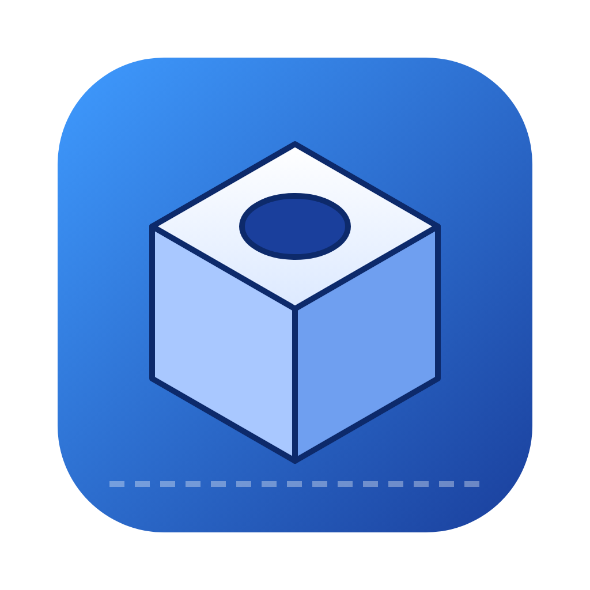

# OpenCAD Studio

A **free, open-source parametric 3D CAD app for Mac (Apple Silicon) and Windows**, inspired by the Fusion 360 workflow:
sketch → extrude/revolve → modify, with every step recorded on an editable **timeline**.



## Features

| Area | What you get |
| --- | --- |
| **Start screen** | Create a new blank design, start from a template, open `.ocad` designs or `.stl` / `.obj` 3D models, reopen recent files (with thumbnails), drag & drop files, and recover unsaved work. Click the **⌂ OpenCAD** button (or **File → Home**, ⇧⌘H) to get back to it. |
| **Sketching** | Sketch on the XY / XZ / YZ planes **or on any flat face of a body**. Line/polyline, rectangle, center rectangle, circle, polygon and slot tools, grid and point snapping, typed exact dimensions, construction geometry. Shapes inside other shapes become holes. |
| **Solid features** | Extrude (one side, flipped or symmetric; rounded corners, taper, twist), Revolve, Box, Cylinder (both with edge fillets), Sphere, Cone, Torus, STL import. |
| **Operations** | New body / Join / Cut / Intersect on every feature. Extruding a face sketch automatically joins, or cuts when you extrude inward. |
| **Modify** | Move/Rotate with an on-screen gizmo, Scale, Combine (join/cut/intersect bodies), Mirror, Linear and Circular patterns, Hollow (shell). |
| **Parametric** | Every feature stays editable on the timeline. Fields take expressions such as `width/2 + 3` or `1in`, using named **Parameters**. Suppress, reorder, rename or delete steps. |
| **Inspect** | Measure distances, see size, volume, surface area and estimated PLA mass. |
| **Files** | Save/open `.ocad` designs and open/import **STL** and **OBJ** models (double-click in Finder works), export **STL** and **OBJ** for 3D printing, save PNG images. Models that aren't watertight still open for reference. |
| **View** | Orbit/pan/zoom (trackpad friendly), standard views, perspective/orthographic, wireframe, X-ray, edges, grid. |

Geometry comes from the [Manifold](https://github.com/elalish/manifold) kernel, which guarantees watertight solids, so your exports are always printable. Rendering uses [three.js](https://threejs.org).

## Install

Open the **Actions** tab of this repo, click the latest **Build apps** run, and download the
artifact for your computer (you need to be signed in to GitHub).

### Mac

1. Download `OpenCAD-Studio-macOS` and unzip it.
2. Open `OpenCAD Studio-…-arm64.dmg` (Apple Silicon: M1/M2/M3/M4…) or `OpenCAD Studio-…-x64.dmg` (Intel Macs).
3. Drag **OpenCAD Studio** into **Applications**.
4. Open the app. The first time, macOS will probably block it, because it isn't notarized by Apple
   (that requires a paid Apple Developer account). Follow the steps below.

#### If the app is blocked, bounces in the Dock, or nothing happens

On newer macOS versions (including macOS 27), Gatekeeper silently stops apps that aren't notarized: the
icon bounces in the Dock and the app never opens. Try these in order.

**A. Allow it in System Settings**

1. Try to open OpenCAD Studio once and let it fail.
2. Open **System Settings → Privacy & Security** and scroll down to **Security**.
3. Click **Open Anyway** next to *"OpenCAD Studio" was blocked…* and confirm with your password or Touch ID.
4. Open the app again and click **Open**.

**B. Re-sign it on your Mac (if there is no Open Anyway button, or it still won't open)**

Open **Terminal** (press ⌘Space, type `Terminal`, press Enter), paste this whole line and press Enter:

```bash
pkill -9 -f "OpenCAD Studio"; mkdir -p ~/Applications; rm -rf ~/Applications/"OpenCAD Studio.app"; ditto --noextattr --noqtn "/Applications/OpenCAD Studio.app" ~/Applications/"OpenCAD Studio.app" && codesign --force --deep --sign - ~/Applications/"OpenCAD Studio.app" && open ~/Applications/"OpenCAD Studio.app"
```

This stops any stuck copy of the app, makes a fresh copy in your personal **Applications** folder
(`~/Applications`), signs that copy on your own Mac, and opens it. Afterwards:

- Use that copy from now on: in Finder press **⌘⇧H**, open **Applications**, and drag **OpenCAD Studio**
  to your Dock.
- Drag the old copy in the main **Applications** folder to the Trash.

If Terminal prints **Operation not permitted**, give Terminal permission to manage apps: open
**System Settings → Privacy & Security → App Management**, turn on **Terminal**, quit and reopen
Terminal, and paste the line again.

**C. Check what macOS is doing (to report a problem)**

```bash
spctl --assess -vv ~/Applications/"OpenCAD Studio.app"; log show --last 2m --style compact --predicate 'process == "kernel" OR process == "syspolicyd"' 2>/dev/null | grep -i opencad | tail -10; cat ~/Library/Logs/"OpenCAD Studio"/main.log 2>/dev/null | tail -20
```

A line saying `ASP: Security policy would not allow process` means Gatekeeper is still blocking the app,
so use step **A** or **B**. Messages from `main.log` come from the app itself. Please include them when
you open an issue.

### Windows 10/11 (64-bit)

1. Download `OpenCAD-Studio-Windows`, unzip it and run `OpenCAD Studio Setup ….exe`.
2. The installer isn't code-signed, so Windows may say "Windows protected your PC".
   Click **More info → Run anyway**.
3. Start **OpenCAD Studio** from the Start menu or the desktop shortcut.

## Run or build from source

Requires [Node.js](https://nodejs.org) 20+.

```bash
npm install
npm start            # build and launch the desktop app
npm run dev          # or run it in your browser at http://localhost:5173
npm test             # geometry kernel tests
npm run dist:mac     # build the Apple Silicon .dmg into release/ (run on a Mac)
npm run dist:win     # build the Windows installer into release/ (run on Windows)
```

To publish a downloadable release, push a version tag (e.g. `git tag v1.0.0 && git push origin v1.0.0`);
the GitHub workflow attaches the Mac `.dmg` and Windows `.exe` to a draft GitHub Release.

## Quick start

1. On the start screen click **New design**, then press **S** (Sketch) and click the **XY** plane.
2. Choose **Rectangle**, click two corners (or click once and type `40,20` then Enter).
3. Add a **Circle** inside it to make a hole, then click **Finish Sketch**.
4. Press **E** (Extrude), type a distance, press **Enter**.
5. Press **S** again and click the **top face** to sketch on it. Extrude that sketch inward (a negative distance) to cut a pocket.
6. Click any step in the timeline to change its dimensions later. The model rebuilds automatically.
7. Use **Export → STL** to send it to your slicer.

The start screen also has templates: a parametric bracket, an electronics enclosure, a vase and a spoked wheel.

## Keyboard shortcuts

| Key | Action | Key | Action |
| --- | --- | --- | --- |
| S | Sketch | E | Extrude |
| B | Box | Y | Cylinder |
| M | Move selected body | J | Combine selected bodies |
| I | Measure | F | Fit view |
| 0 / 1 / 2 / 3 | Home / Front / Top / Right | Delete | Remove selected bodies |
| ⌘Z / ⇧⌘Z (Ctrl+Z / Ctrl+Shift+Z) | Undo / Redo | ⌘S (Ctrl+S) | Save |
| Esc | Cancel / deselect | Enter | Accept dialog / finish sketch |

In a sketch: **L** line, **R** rectangle, **T** center rectangle, **C** circle, **P** polygon, **O** slot,
**V** select, **X** toggle construction, and type numbers while drawing for exact sizes.

## Limitations compared with Fusion 360

OpenCAD Studio is a mesh-based (not B-rep) modeler, so it doesn't have:
STEP/IGES import or export, fillets/chamfers on arbitrary selected edges (fillets are available on boxes,
cylinders and extruded profile corners), a sketch constraint solver, assemblies/joints, drawings, CAM or
simulation.

## Project layout

```
electron/        desktop app shell: window, native menus, file dialogs
src/kernel/      parametric engine: features, expressions, regeneration (pure JS + Manifold WASM)
src/viewport.js  three.js 3D view, picking, gizmo, camera
src/sketcher.js  interactive 2D sketch editor
src/app.js       UI: toolbar, browser, timeline, property panels, files
src/landing.js   start screen: new design, open, recents, templates
tests/           kernel tests (node --test)
```

## License

MIT
